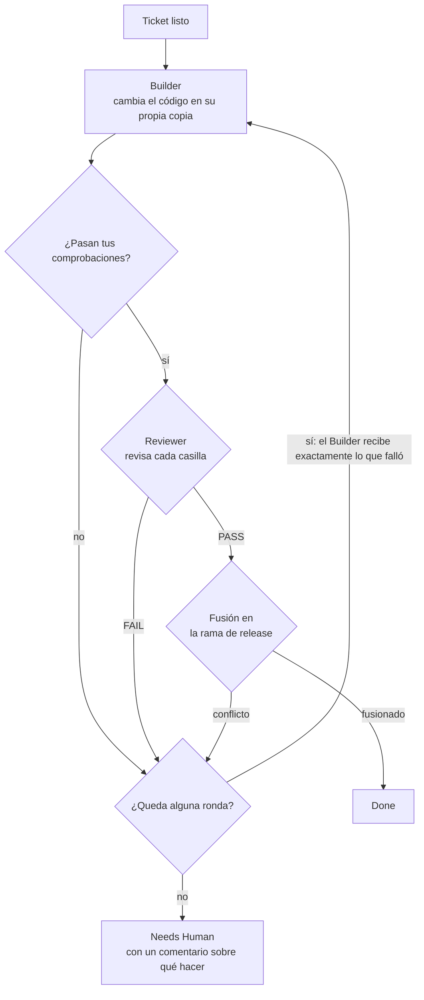

<p align="center">
  <picture>
    <source media="(prefers-color-scheme: dark)" srcset="assets/dynamo-logo-dark.svg">
    <source media="(prefers-color-scheme: light)" srcset="assets/dynamo-logo-light.svg">
    
  </picture>
</p>

<p align="center">
  <strong>Entrega una lista de tickets. Vuelve y encuentra una rama revisada, lista para tu aprobación.</strong>
</p>

<p align="center">
  Una fábrica de agentes para <a href="https://code.claude.com">Claude Code</a>: los agentes construyen, prueban y revisan
  tus tickets sin supervisión, y un programa, no un agente, se encarga de que cumplan.
</p>

<p align="center">
  <a href="https://github.com/SergioLizana/Dynamo/releases"></a>
  <a href="https://github.com/SergioLizana/Dynamo/actions/workflows/ci.yml"></a>
  <a href="LICENSE"></a>
  
  
  
</p>

<p align="center">
  <a href="README.md">English</a> · <b>Español</b>
</p>

<p align="center">
  <a href="#por-qué-dynamo">Por qué Dynamo</a> ·
  <a href="#cómo-funciona">Cómo funciona</a> ·
  <a href="#inicio-rápido">Inicio rápido</a> ·
  <a href="#guía-paso-a-paso">Guía</a> ·
  <a href="#comandos">Comandos</a> ·
  <a href="#configuración">Configuración</a> ·
  <a href="#seguridad">Seguridad</a>
</p>

---

## Por qué Dynamo

Un agente de programación es rápido, pero si lo dejas solo en un trabajo largo acaba desviándose: olvida lo que se
decidió, se para a preguntar, da por bueno su propio trabajo y te deja un diff enorme en el que no puedes confiar.

Dynamo divide ese trabajo en tickets pequeños y rodea cada uno de un proceso:

- **Un programa dirige el proceso.** El orden, las rondas, las fusiones y las paradas los decide un código normal, no el
  criterio de un modelo. No se cansa ni se convence a sí mismo de nada.
- **Quien construye no juzga.** Un agente Builder escribe el cambio en su propia copia del repositorio. Después, otro
  agente distinto, el Reviewer, que solo lee y no participa en la conversación del Builder, lo contrasta con el ticket y
  aporta pruebas de cada casilla.
- **Tus comprobaciones son el filtro.** Nada llega al Reviewer si no pasan tus tests, tu linter o tu compilación.
- **La última palabra es tuya.** Durante una ejecución, Dynamo no hace push ni toca tu rama principal. Te deja una rama de
  release y un informe; abrir y aprobar la pull request te corresponde a ti.

Dynamo se construye con Dynamo. La versión 0.5.0 fueron 30 tickets: 16 pasaron a la primera y 14 necesitaron la segunda
ronda, con un coste total de 50,09 USD, unos 1,67 USD por ticket.<sup>[1](#medido)</sup>

## Cómo funciona

El trabajo tiene tres etapas. Tú diriges la primera y la última; la del medio funciona sola.

| Etapa | Quién la dirige | Qué ocurre |
|---|---|---|
| **Planificar** | Tú, con Claude | Una idea se convierte en decisiones cerradas, una especificación y una lista de tickets en un tablero de GitHub |
| **Construir** | Dynamo, sin supervisión | Cada ticket se construye, se comprueba, se revisa y se fusiona en la rama de release |
| **Publicar** | Tú | Lees el informe, apruebas la pull request y cierras la versión |

Cada ticket recorre el mismo ciclo en su propia copia del repositorio, con un máximo de dos rondas:



Puedes seguirlo en directo en el tablero, donde un programa mueve cada tarjeta. Las columnas conservan su nombre en inglés
porque así aparecen en GitHub:

| Columna | Significado |
|---|---|
| *Backlog* | Escrito, pero aparcado: no se construirá hasta que lo pases a *Todo* |
| *Todo* | Esperando su turno |
| *Build* | El Builder está cambiando el código |
| *Verify* | Se están ejecutando tus comprobaciones automáticas |
| *Review* | El Reviewer está juzgando el cambio |
| *Merge* | Aprobado, y fusionándose en la rama de release |
| *Needs Human* | Atascado, con un comentario que explica qué falló y cómo relanzarlo |
| *Done* | Fusionado en la rama de release. El issue sigue abierto hasta que la versión llega a tu rama principal |

## Funcionalidades

| | |
|---|---|
| **De la idea a los tickets** | Definición guiada, una especificación escrita y tickets pequeños, con sus bloqueos y criterios comprobables |
| **Listas sin supervisión** | Lanza un ticket, varios o todos los que estén listos, y olvídate |
| **Tickets en paralelo** | Cada uno en su propio git worktree, en el orden que permiten los bloqueos, y fusionados de uno en uno |
| **Una segunda oportunidad** | Un ticket que falla tiene otra ronda con el fallo exacto; después se detiene y te avisa |
| **Aguanta el límite de uso** | Una lista en pausa no gasta rondas y continúa desde la fase en la que estaba |
| **Presupuestos y tiempos máximos** | Por agente, para que un ticket perdido se detenga en vez de gastar sin fin |
| **Informe de la release** | Tickets fusionados, detenidos y omitidos, el coste de cada uno y lo que los agentes dejaron pendiente |
| **Avisos** | Un mensaje opcional de una línea a un tema tipo [ntfy](https://ntfy.sh) cuando una lista termina o se pausa |
| **Preparación con un solo comando** | Tablero, etiquetas, permisos, CI y Dependabot, probando tus comprobaciones antes de escribir nada |
| **Sin compilación ni dependencias** | Node puro ejecutando TypeScript directamente: solo tienes que instalar el plugin |

## Inicio rápido

Necesitas [Claude Code](https://code.claude.com) (probado con 2.1.318), [Node.js](https://nodejs.org) **24.22.2**, `git`
y la [CLI de GitHub](https://cli.github.com) (probada con 2.102.0). Desde una terminal en la raíz de tu proyecto:

```text
claude plugin marketplace add SergioLizana/Dynamo
claude plugin install dynamo@dynamo --scope project
```

Abre Claude Code en el proyecto y luego:

```text
/dynamo:setup
/dynamo:discover añadir modo oscuro a la página de ajustes
/dynamo:to-spec
/dynamo:to-tickets
/dynamo:autopilot
```

El resto de esta página explica cada uno de estos pasos.

## Guía paso a paso

### 1. Prepara tu equipo

- **Claude Code**, con la sesión iniciada. Dynamo se probó con la 2.1.318.
- **Node.js 24.22.2.** Dynamo ejecuta TypeScript directamente, sin compilador, y es posible que no funcione con un Node
  anterior; antes de la 24.20.0 un proceso puede cerrarse con un error al terminar en Windows.
- **git**, con un nombre y un email configurados, porque el setup hace un commit con su trabajo.
- **CLI de GitHub**, con la sesión iniciada y acceso a Projects. Dynamo se probó con la 2.102.0:

  ```text
  gh auth login
  gh auth refresh -s project
  ```

- **Un repositorio de GitHub** para tu proyecto, clonado y con al menos un commit.

### 2. Instala el plugin

Desde una terminal en la raíz de tu proyecto:

```text
claude plugin marketplace add SergioLizana/Dynamo
claude plugin install dynamo@dynamo --scope project
```

El ámbito `project` instala el plugin solo en este proyecto, así que Dynamo no aparece en tus otros proyectos. Abre
Claude Code en el proyecto (o reinicia la sesión) para que se carguen las skills y los agentes.

### 3. Prepara tu proyecto

Abre Claude Code en la raíz de tu proyecto y ejecuta `/dynamo:setup`. La skill lee los scripts del proyecto, propone tus
comprobaciones automáticas y te pide que las confirmes. Antes de escribir nada, ejecuta cada una en una copia limpia. Si
todas pasan, el setup:

- copia el tablero plantilla y lo enlaza con tu repositorio;
- escribe `.claude/factory.json` y `.claude/settings.json`, y añade `.claude/worktrees/` a los ficheros ignorados;
- crea las etiquetas, un workflow de CI si el proyecto no tiene ninguno y Dependabot si usas npm;
- hace commit de todo en la rama de release (`release/x.y.z`) y te indica el `git push` que debes ejecutar.

> [!IMPORTANT]
> Las comprobaciones se ejecutan en una copia limpia, sin `node_modules` y sin shell. Un script que necesite paquetes debe
> instalarlos él mismo, y tiene que estar en un commit antes de lanzar el setup. En `package.json`,
> `"verify": "npm ci && node --run build"`; como comprobación, `node --run verify`. Usa `node --run` en lugar de
> `npm run`, que en Windows no puede arrancar sin shell.

### 4. Escribe los tickets

```text
/dynamo:discover unas palabras sobre la idea
/dynamo:to-spec
/dynamo:to-tickets
```

`/dynamo:discover` te hace preguntas por rondas hasta cerrar todas las decisiones. `/dynamo:to-spec` las deja escritas en
una épica. `/dynamo:to-tickets` propone los tickets con sus bloqueos y solo los crea en el tablero cuando apruebas la lista.

La calidad se juega en los tickets. El Reviewer juzga sus casillas, así que cada una debe poder demostrarse con un comando
o con una lectura:

```markdown
## Problem
El botón de exportar agota el tiempo de espera en informes de más de 10.000 filas.

## What it delivers
- Los informes grandes se exportan en segundo plano y el usuario recibe un enlace.

## Acceptance criteria
- [ ] Un informe de 50.000 filas se exporta sin agotar el tiempo de espera.
- [ ] El enlace funciona durante 24 horas y después devuelve 404.

## Out of scope
El formato del fichero exportado.
```

El texto del ticket va en el idioma de `project.documentsLanguage`; los títulos de sección de la plantilla son siempre los
mismos.

### 5. Lanza la lista

```text
/dynamo:autopilot            todos los tickets listos
/dynamo:autopilot 12 13      solo estos tickets
```

La lista se ejecuta en segundo plano, pero los agentes corren en tu ordenador: el equipo tiene que seguir encendido. Al
terminar, imprime una línea JSON con el resultado de cada ticket:

| Código de salida | Significado |
|---|---|
| `0` | Se fusionaron todos los tickets |
| `1` | Un ticket se detuvo o la lista se pausó por el límite de uso |
| `2` | Se lanzó de forma incorrecta, por ejemplo con un número de ticket que no existe |

### 6. Revisa y publica

Cuando termine la lista, lee el informe en `.claude/worktrees/release-report-<base>.md`. La línea JSON incluye además los
comandos para subir la rama de release y abrir la pull request. Dynamo no los ejecuta: ese paso es tuyo. Una vez fusionada
la pull request:

```text
/dynamo:close-release patch
```

Crea el milestone, la etiqueta, la GitHub Release y la siguiente rama de release. Usa `patch`, `minor` o `major` para indicar
la versión que viene después.

### Si algo se detiene

| Qué ves | Qué significa | Qué hacer |
|---|---|---|
| La lista se ha pausado | Un agente llegó al límite de uso. No se ha gastado ninguna ronda | Lanza el mismo `/dynamo:autopilot` cuando se restablezca el límite; seguirá desde la fase en la que estaba |
| Una tarjeta en *Needs Human* | El ticket agotó sus rondas, su presupuesto o su tiempo máximo | Lee su comentario y resuelve lo que indica, pasa la tarjeta a *Todo*, borra la rama `ticket/<n>-*` y su copia, y lanza `/dynamo:autopilot <n>` |
| Se omitió un ticket | Uno de sus bloqueos se detuvo en esta ejecución | Relánzalo cuando el bloqueo esté fusionado |
| «held by the run of pid N» | Hay otra ejecución en marcha | Espera a que termine. Solo trabaja una a la vez |

## Comandos

Todos los comandos los lanzas tú; los agentes nunca los inician por su cuenta.

| Comando | Qué hace |
|---|---|
| `/dynamo:setup` | Instala la fábrica en el proyecto actual |
| `/dynamo:discover [idea o #épica]` | Desarrolla una idea contigo hasta cerrar todas las decisiones |
| `/dynamo:to-spec` | Escribe en una épica las decisiones de la conversación |
| `/dynamo:to-tickets [#épica]` | Divide una épica en tickets con sus bloqueos, tras tu aprobación |
| `/dynamo:autopilot [n ...]` | Construye los tickets indicados o todos los que estén listos |
| `/dynamo:park <n ...>` | Pasa tickets ya escritos a *Backlog* para que no se construyan todavía |
| `/dynamo:backlog «idea»` | Pone una idea en el tablero como una issue corta con la etiqueta de idea, su tarjeta en *Backlog* |
| `/dynamo:close-release <patch\|minor\|major>` | Cierra la versión cuando su pull request está fusionada |

## Configuración

El setup escribe `.claude/factory.json`. Estos son los valores que más probablemente querrás cambiar:

| Valor | Por defecto | Qué hace |
|---|---|---|
| `project.checks` | Los tuyos | Los comandos que deben pasar para que un ticket llegue al Reviewer |
| `project.ticketsAtOnce` | `1` | Cuántos tickets se ejecutan a la vez. Con más, se consume antes el límite de uso |
| `project.budgetUsd` | `10` Builder, `4` Reviewer | Lo máximo que puede gastar cada ejecución de cada agente |
| `project.timeoutMinutes` | `30` Builder, `15` Reviewer | Lo máximo que puede durar cada ejecución de cada agente |
| `project.checkTimeoutMinutes` | `15` | Lo máximo que puede durar cada comprobación |
| `project.documentsLanguage` | `English` | El idioma de los tickets, las especificaciones y los veredictos |

Para recibir un aviso cuando una lista termine o se pause, define la variable de entorno `DYNAMO_NOTIFY_URL` con un tema
propio y mantenla fuera de git. Todos los valores se explican en [`guides/factory.md`](guides/factory.md) (en inglés).

## Seguridad

Los agentes se ejecutan en tu ordenador, con tus credenciales de `git` y `gh` y sin nadie que responda a sus preguntas.
Dynamo limita lo que pueden hacer de esta forma:

- **Permisos.** Los agentes usan el modo de permisos `auto` de Claude Code con las confirmaciones desactivadas: todo lo
  que pediría confirmación se deniega.
- **Aislamiento.** Cada ticket trabaja en su propia copia dentro de `.claude/worktrees/`, y el Reviewer no tiene las
  herramientas Edit ni Write.
- **Dos hooks.** Uno rechaza los comandos que escriben fuera del árbol de trabajo; el otro rechaza cambios en tu carpeta
  principal mientras hay una ejecución en marcha.
- **Límites.** Cada agente tiene un presupuesto y un tiempo máximo, y un ticket tiene dos rondas como mucho.
- **Nada se publica solo.** `dynamo run` fusiona en local en la rama de release. No hace push, no abre pull requests y no
  toca tu rama principal.

> [!WARNING]
> Los hooks protegen de los errores de un agente, pero no son un sandbox. Analizan el texto de cada comando, así que un
> script que escriba en otro sitio pasa desapercibido. Usa Dynamo solo con repositorios y tickets de confianza.

## Limitaciones

Dynamo es un proyecto personal y joven. Puede que no sea para ti si:

- **No trabajas con GitHub.** Los tickets son issues de GitHub y el tablero es un GitHub Project.
- **Buscas rapidez en un cambio pequeño.** El ciclo completo tarda más que hacerlo en una sesión. Compensa cuando no vas a
  estar delante.
- **Tus tickets son imprecisos.** El Reviewer solo puede exigir lo que el ticket dice.
- **Necesitas comprobaciones visuales.** No hay un paso con navegador: lo que tus comprobaciones no demuestren queda sin
  demostrar.
- **Tu equipo se suspende.** Si se suspende, los agentes se paran. Y nada relanza una lista en pausa salvo tú o una tarea
  programada.

## Para saber más

Esta documentación técnica solo está en inglés:

- [`dynamo/README.md`](dynamo/README.md): el motor, sus subcomandos y cómo programar el lanzamiento en cada sistema. Una
  tarea programada debe llamar al `dynamo/dynamo.ts` del propio plugin, cuya ruta cambia con cada versión.
- [`guides/factory.md`](guides/factory.md): todos los valores de `factory.json`.
- [`guides/board-guide.md`](guides/board-guide.md): cómo funciona el tablero.
- [`guides/github-board.md`](guides/github-board.md): los comandos del tablero.

## Licencia

[MIT](LICENSE) © 2026 Sergio Lizana.

---

<sub><a name="medido">1</a>. Datos del informe de la versión 0.5.0. Es el coste de los agentes tal como lo indica Claude
Code; no incluye tus propias sesiones, y de un ticket que se rehízo desde cero solo cuenta el último intento.</sub>
