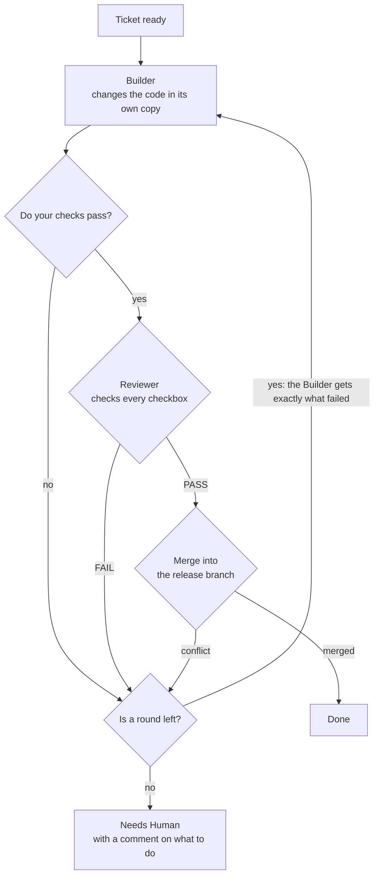

<p align="center">
  <picture>
    <source media="(prefers-color-scheme: dark)" srcset="assets/dynamo-logo-dark.svg">
    <source media="(prefers-color-scheme: light)" srcset="assets/dynamo-logo-light.svg">
    
  </picture>
</p>

<p align="center">
  <strong>Hand over a list of tickets. Come back to a reviewed branch, ready for your approval.</strong>
</p>

<p align="center">
  An agent factory for <a href="https://code.claude.com">Claude Code</a>: agents build, test and review your tickets
  unattended, and a program, not an agent, keeps them honest.
</p>

<p align="center">
  <a href="https://github.com/SergioLizana/Dynamo/releases"></a>
  <a href="https://github.com/SergioLizana/Dynamo/actions/workflows/ci.yml"></a>
  <a href="LICENSE"></a>
  
  
  
</p>

<p align="center">
  <b>English</b> · <a href="README.es.md">Español</a>
</p>

<p align="center">
  <a href="#why-dynamo">Why Dynamo</a> ·
  <a href="#how-it-works">How it works</a> ·
  <a href="#quick-start">Quick start</a> ·
  <a href="#step-by-step-guide">Guide</a> ·
  <a href="#commands">Commands</a> ·
  <a href="#configuration">Configuration</a> ·
  <a href="#safety">Safety</a>
</p>

---

## Why Dynamo

A coding agent is fast, but left alone on a long job it drifts: it forgets what was decided, stops to ask, says its own
work is fine, and leaves you reading a huge diff you cannot trust.

Dynamo splits that job into small tickets and puts a process around each one:

- **A program runs the loop.** Order, rounds, merges and stops are decided by plain code, not by a model's judgement. It
  does not get tired or talk itself into anything.
- **Whoever builds does not judge.** A Builder writes the change in its own copy of the repository. A separate,
  read-only Reviewer, with no part in the Builder's conversation, checks it against the ticket, with evidence for each
  checkbox.
- **Your checks are the gate.** Nothing reaches the Reviewer unless your tests, linter or build pass.
- **You keep the last word.** Dynamo never pushes during a run and never touches your main branch. It leaves a release
  branch and a report; the pull request is yours to open and approve.

Dynamo is built with Dynamo. Release 0.5.0 was 30 tickets: 16 passed in the first round and 14 needed the second, for
50.09 USD in total, about 1.67 USD per ticket.<sup>[1](#measured)</sup>

## How it works

The work has three stages. You lead the first and the last; the middle one runs by itself.

| Stage | Who leads | What happens |
|---|---|---|
| **Plan** | You, with Claude | An idea becomes closed decisions, a spec and a list of tickets on a GitHub board |
| **Build** | Dynamo, unattended | Every ticket is built, checked, reviewed and merged into the release branch |
| **Release** | You | You read the report, approve the pull request and close the release |

Each ticket goes through the same loop in its own copy of the repository, with at most two rounds:



You can follow it live on the board, where a program moves every card:

| Column | Meaning |
|---|---|
| *Backlog* | Written, but parked: it will not be built until you move it to *Todo* |
| *Todo* | Waiting for its turn |
| *Build* | The Builder is changing the code |
| *Verify* | Your automatic checks are running |
| *Review* | The Reviewer is judging the change |
| *Merge* | Approved, and being merged into the release branch |
| *Needs Human* | Stuck, with a comment saying what failed and how to relaunch it |
| *Done* | Merged into the release branch. The issue stays open until the release reaches your main branch |

## Features

| | |
|---|---|
| **From idea to tickets** | Guided discovery, a written spec, and small tickets with blockers and checkable criteria |
| **Unattended lists** | Launch one ticket, several or everything ready, and walk away |
| **Parallel tickets** | Each in its own git worktree, in the order the blockers allow, merged one at a time |
| **A second chance** | A failed ticket gets one more round with the exact failure; after that it stops and tells you |
| **Survives the usage limit** | A paused list spends no round and resumes from the phase it was in |
| **Budgets and timeouts** | Per agent, so a lost ticket stops instead of spending without end |
| **Release report** | Tickets merged, stopped and skipped, the cost of each, and what agents left for later |
| **Notifications** | An optional one-line notice to an [ntfy](https://ntfy.sh)-style topic when a list ends or pauses |
| **Project setup in one command** | Board, labels, permissions, CI and Dependabot, with your checks rehearsed before anything is written |
| **No build, no dependencies** | Plain Node running TypeScript directly: nothing to install but the plugin |

## Quick start

You need [Claude Code](https://code.claude.com) (tested with 2.1.318), [Node.js](https://nodejs.org) **24.22.2**, `git`
and the [GitHub CLI](https://cli.github.com) (tested with 2.102.0). From a terminal at the root of your project:

```text
claude plugin marketplace add SergioLizana/Dynamo
claude plugin install dynamo@dynamo --scope project
```

Open Claude Code in the project, then:

```text
/dynamo:setup
/dynamo:discover add a dark mode to the settings page
/dynamo:to-spec
/dynamo:to-tickets
/dynamo:autopilot
```

The rest of this page explains each of these steps.

## Step-by-step guide

### 1. Prepare your machine

- **Claude Code**, signed in. Dynamo was tested with 2.1.318.
- **Node.js 24.22.2.** Dynamo runs TypeScript directly with no compiler, and an older Node may not run it; before 24.20.0
  a process can also crash on exit on Windows.
- **git**, with a name and an email configured, because the setup commits its work.
- **GitHub CLI**, signed in with access to Projects. Dynamo was tested with 2.102.0:

  ```text
  gh auth login
  gh auth refresh -s project
  ```

- **A GitHub repository** for your project, cloned, with at least one commit.

### 2. Install the plugin

From a terminal at the root of your project:

```text
claude plugin marketplace add SergioLizana/Dynamo
claude plugin install dynamo@dynamo --scope project
```

The `project` scope installs the plugin for this project only, so Dynamo stays out of your other projects. Open Claude
Code in the project (or restart the session) so that the skills and agents load.

### 3. Set up your project

Open Claude Code at the root of your project and run `/dynamo:setup`. The skill reads your project's scripts, proposes
your automatic checks and asks you to confirm them. Each check is rehearsed once, in a clean copy, before anything is
written. If they pass, the setup:

- copies the template board and links it to your repository;
- writes `.claude/factory.json` and `.claude/settings.json`, and ignores `.claude/worktrees/`;
- creates the labels, a CI workflow if the project has none, and Dependabot if you use npm;
- commits all of that on the release branch (`release/x.y.z`) and tells you the `git push` to run.

> [!IMPORTANT]
> Checks run in a clean copy with no `node_modules` and without a shell. A script that needs packages must install them
> itself, and it must be committed before the setup runs. In `package.json`, `"verify": "npm ci && node --run build"`;
> as a check, `node --run verify`. Use `node --run` rather than `npm run`, which cannot start without a shell on Windows.

### 4. Write the tickets

```text
/dynamo:discover a few words about the idea
/dynamo:to-spec
/dynamo:to-tickets
```

`/dynamo:discover` asks you in rounds until every decision is closed. `/dynamo:to-spec` writes those decisions as an epic.
`/dynamo:to-tickets` proposes the tickets with their blockers, and creates them on the board only once you approve the
list.

The tickets are where quality is won or lost. The Reviewer judges their checkboxes, so each one must be something a
command or a reading can prove:

```markdown
## Problem
The export button times out on reports over 10,000 rows.

## What it delivers
- Large reports export in the background and the user gets a link.

## Acceptance criteria
- [ ] A report of 50,000 rows exports without a timeout.
- [ ] The link is valid for 24 hours and then returns 404.

## Out of scope
The layout of the exported file.
```

### 5. Launch the list

```text
/dynamo:autopilot            every ticket that is ready
/dynamo:autopilot 12 13      only these tickets
```

The list runs in the background, but the agents run on your computer, so it has to stay on. When the list ends, it prints
one JSON line with the result of each ticket:

| Exit code | Meaning |
|---|---|
| `0` | Every ticket was merged |
| `1` | A ticket stopped, or the list paused at the usage limit |
| `2` | It was called wrong, for example with a bad ticket number |

### 6. Review and release

When the list ends, read the report in `.claude/worktrees/release-report-<base>.md`. The JSON line also holds the
commands to push the release branch and open the pull request. Dynamo does not run them: that step is yours. Once you
have merged the pull request:

```text
/dynamo:close-release patch
```

It makes the milestone, the tag, the GitHub Release and the next release branch. Use `patch`, `minor` or `major` for the
version that follows.

### When something stops

| What you see | What it means | What to do |
|---|---|---|
| The list paused | An agent hit the usage limit. No round was spent | Run the same `/dynamo:autopilot` after the reset time; it goes on from the phase it was in |
| A card in *Needs Human* | The ticket used its rounds, or hit a budget or a timeout | Read its comment and solve what it says, move the card to *Todo*, delete the branch `ticket/<n>-*` and its copy, and run `/dynamo:autopilot <n>` |
| A ticket was skipped | One of its blockers stopped in this run | Relaunch it once the blocker is merged |
| «held by the run of pid N» | Another run is alive | Wait for it. Only one run works at a time |

## Commands

Every command is launched by you; agents never start them on their own.

| Command | What it does |
|---|---|
| `/dynamo:setup` | Puts the factory in the current project |
| `/dynamo:discover [idea or #epic]` | Talks an idea through until every decision is closed |
| `/dynamo:to-spec` | Writes the decisions of the conversation as an epic |
| `/dynamo:to-tickets [#epic]` | Splits an epic into tickets with their blockers, after your approval |
| `/dynamo:autopilot [n ...]` | Builds the tickets given, or every ticket that is ready |
| `/dynamo:park <n ...>` | Moves written tickets to *Backlog*, so they are not built yet |
| `/dynamo:close-release <patch\|minor\|major>` | Closes the release once its pull request is merged |

## Configuration

The setup writes `.claude/factory.json`. These are the values you are most likely to change:

| Value | Default | What it does |
|---|---|---|
| `project.checks` | Yours | The commands that must pass before a ticket reaches the Reviewer |
| `project.ticketsAtOnce` | `1` | How many tickets run at the same time. More spends more of your usage limit at once |
| `project.budgetUsd` | `10` Builder, `4` Reviewer | The most one run of each agent may spend |
| `project.timeoutMinutes` | `30` Builder, `15` Reviewer | The most one run of each agent may take |
| `project.checkTimeoutMinutes` | `15` | The most each check may take |
| `project.documentsLanguage` | `English` | The language of tickets, specs and verdicts |

For a notice when a list ends or pauses, set the environment variable `DYNAMO_NOTIFY_URL` to a topic of your own, and keep
it out of git. Every value is explained in [`guides/factory.md`](guides/factory.md).

## Safety

Agents run on your computer, with your `git` and `gh` credentials and with nobody there to answer a prompt. Dynamo limits
what they can do, in this way:

- **Permissions.** Agents run in Claude Code's `auto` permission mode with prompts off: whatever would ask is denied.
- **Isolation.** Each ticket works in its own copy under `.claude/worktrees/`, and the Reviewer has no Edit or Write tool.
- **Two hooks.** One refuses commands that write outside the working tree; the other refuses changes to your main folder
  while a run is alive.
- **Limits.** Each agent has a budget and a timeout, and a ticket has at most two rounds.
- **No publishing.** `dynamo run` merges locally into the release branch. It does not push, open a pull request or touch
  your main branch.

> [!WARNING]
> The hooks guard against an agent's mistakes; they are not a sandbox. They read the text of a command, so a script that
> writes elsewhere goes unseen. Run Dynamo only on repositories and tickets you trust.

## Limitations

Dynamo is a young, personal project. It may not suit you if:

- **You are not on GitHub.** Tickets are GitHub issues, and the board is a GitHub Project.
- **You want speed on one small change.** The full loop takes longer than doing it in a session. It pays off when you are
  not there to supervise.
- **Your tickets are vague.** The Reviewer can only hold a change to what the ticket says.
- **You need visual checks.** There is no browser step, so what your checks cannot prove is not proven.
- **Your machine sleeps.** Agents stop if it does. Nothing relaunches a paused list unless you do it, or schedule it.

## Going further

- [`dynamo/README.md`](dynamo/README.md): the engine, its subcommands and a scheduled launch on each system. A scheduled
  task must call the plugin's own `dynamo/dynamo.ts`, whose path changes with each version.
- [`guides/factory.md`](guides/factory.md): every value of `factory.json`.
- [`guides/board-guide.md`](guides/board-guide.md): how the board works.
- [`guides/github-board.md`](guides/github-board.md): the raw board commands.

## License

[MIT](LICENSE) © 2026 Sergio Lizana.

---

<sub><a name="measured">1</a>. From the release report of 0.5.0. Agents' cost as Claude Code reports it; your own sessions
are not included, and a ticket restarted from zero counts only its last attempt.</sub>
